<div align="center">

# 🌌 Aura App Store (v2.0)
### A Minimal, Modern macOS-Inspired App Store tailored for Hyprland on Arch Linux

[](https://archlinux.org)
[](https://hyprland.org)
[](https://gnome.pages.gitlab.gnome.org/libadwaita/)
[](https://www.python.org/)
[](https://www.docker.com/)
[](LICENSE)

*An ultra-fast, visually refined App Store designed exclusively for **Hyprland (Wayland)** on Arch Linux, CachyOS, and EndeavourOS. Features dual-tier Pacman + AUR search, a **Seamless Native `.deb` Package Bridge**, a dedicated **Hyprland Hub & Wayland Optimizer**, **System Health & Pacman Doctor**, isolated Docker application sandboxing, and lifetime passwordless authorization.*

---

</div>

## ✨ What's New in Aura v2.0

- **📦 Seamless Native `.deb` Package Bridge (`DebPackageManager`)**:
  - Install any Debian/Ubuntu `.deb` file on Arch Linux & Hyprland in one click — via Drag-and-Drop, File Picker, `~/Downloads` auto-scanner, direct HTTP/HTTPS `.deb` URLs, or double-clicking in your file manager (`aura package.deb`).
  - **Pure-Python + `bsdtar` `.deb` Inspector**: Extracts metadata, icons, and `.desktop` entries from `control.tar.*` and `data.tar.*` (`.gz`, `.xz`, `.zst`, `.bz2`) before installation.
  - **175+ Debian-to-Arch Dependency Translator**: Automatically translates Debian/Ubuntu library names (including Ubuntu 24.04 `t64` packages) to Arch Linux equivalents and installs missing official repository dependencies via `pacman`.
  - **Arch FHS Normalization & `pacman -U` Tracking**: Merges `/bin`, `/sbin` into `/usr/bin` and `/lib`, `/lib64`, `/usr/lib/x86_64-linux-gnu` into `/usr/lib`, builds a compliant `.pkg.tar.zst` package, and installs via `pacman -U` so every file is tracked by Pacman for clean 1-click uninstallation.
  - **Hyprland Electron Auto-Fix**: Detects Electron/Chromium `.deb` apps and automatically injects `--ozone-platform-hint=auto` into `.desktop` launchers so they render natively on Wayland without XWayland blur.

- **🪟 Dedicated Hyprland Hub (`HyprlandManager`)**:
  - **Live Wayland & Compositor Diagnostics**: Inspects `hyprctl version`, connected monitors (resolution, refresh rate, scale), `xdg-desktop-portal-hyprland`, Polkit agents, status bars (`waybar`, `ags`, `eww`), wallpaper daemons (`hyprpaper`, `swww`), notification daemons (`swaync`, `mako`, `dunst`), and PipeWire audio.
  - **1-Click Window Rules & `SUPER + A` Installer**: Injects Aura's floating window rules into `~/.config/hypr/hyprland.conf` and reloads Hyprland live via `hyprctl reload`.
  - **1-Click Electron & Chromium Wayland Ozone Optimizer**: Configures `electron-flags.conf`, `code-flags.conf`, `spotify-flags.conf`, `chromium-flags.conf`, and `brave-flags.conf` for crisp native Wayland rendering on HiDPI displays.
  - **Curated Hyprland Ecosystem Catalog**: Install `waybar`, `rofi-wayland`, `hyprpaper`, `hyprlock`, `hypridle`, `hyprpicker`, `swaync`, `swww`, `wlogout`, `nwg-look`, `nwg-displays`, and `grim` in one click.

- **🩺 System Health & Pacman Doctor (`SystemDoctor`)**:
  - **Stale Database Lock Recovery**: Automatically detects and clears stale `/var/lib/pacman/db.lck` files when no package manager process is running.
  - **Orphaned Package Cleaner**: Scans unused dependencies (`pacman -Qdt`) and removes them in one click.
  - **Arch Linux GPG Keyring Repair**: Re-initializes and populates `pacman-key` and refreshes `archlinux-keyring` to resolve signature verification errors.

- **🔐 Native GTK4/Adwaita AskPass & Hardened Backend**:
  - Built-in GTK4/Libadwaita graphical password prompt in `aura-askpass` guarantees smooth authentication on Hyprland even without `zenity` or `kdialog`.
  - Full `--sudoflags -A` propagation for `paru` and `yay` in headless background threads, plus a native `git clone` + `makepkg -si` fallback when no AUR helper is installed.
  - Local `/var/lib/pacman/local` database indexing and `zstd` sync DB fallback.
  - PipeWire & PulseAudio socket forwarding for Docker sandboxed GUI applications.

---

## 📸 Screenshots

<div align="center">

### 🌟 Discover Hub
Curated essential software, development suites, privacy tools, and media applications arranged in dynamic multi-column responsive grids.

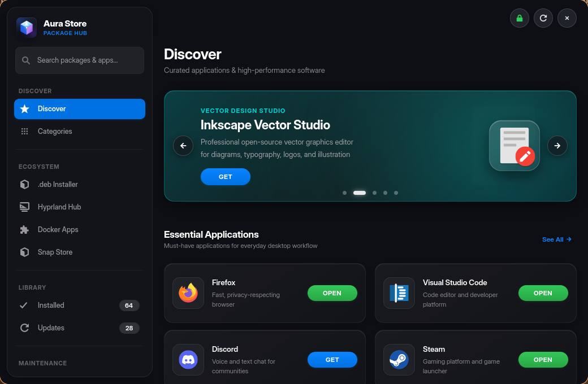

---

### 📦 Seamless Native `.deb` Package Bridge
Inspect, translate dependencies, normalize FHS paths, and install any Debian/Ubuntu `.deb` file directly into Pacman tracking.

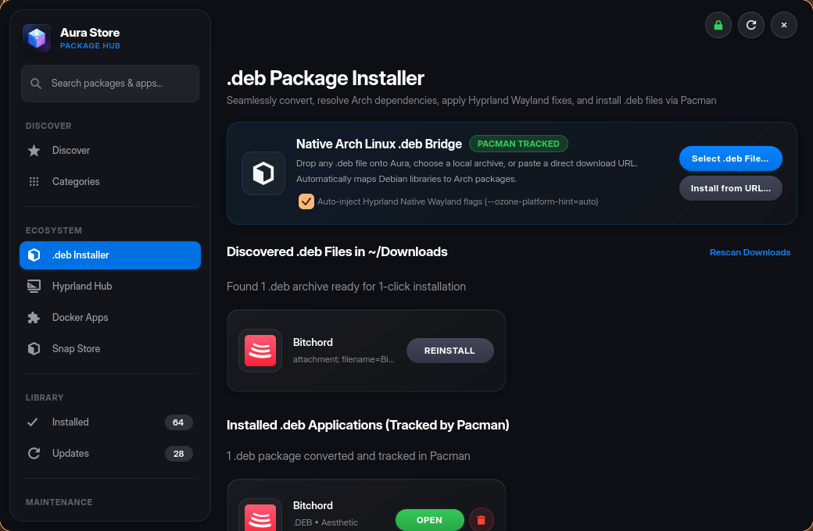

---

### 🪟 Dedicated Hyprland Hub & Wayland Diagnostics
Real-time compositor diagnostics, one-click window rules injection, Electron Wayland Ozone optimization, and curated Hyprland utilities.

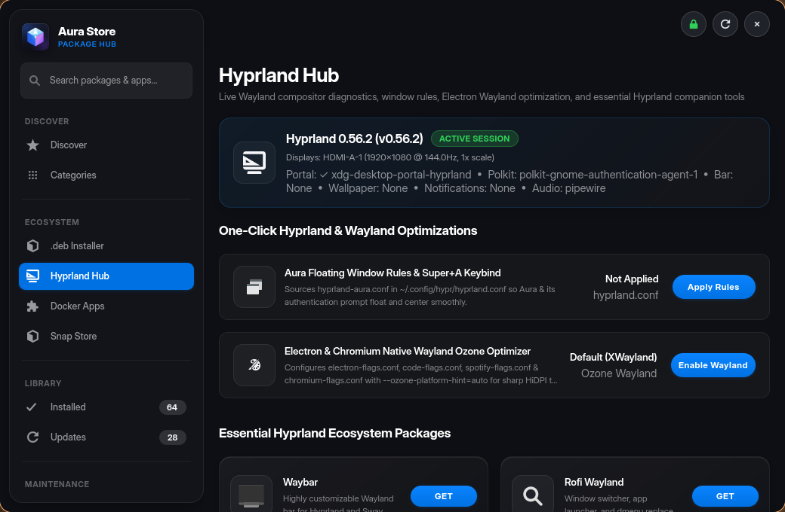

---

### 🐳 Docker OCI Applications Sandbox
Run desktop software in sandboxed containers with zero host package pollution. Automatically generates desktop menu shortcuts and forwards Wayland/OpenGL hardware acceleration.

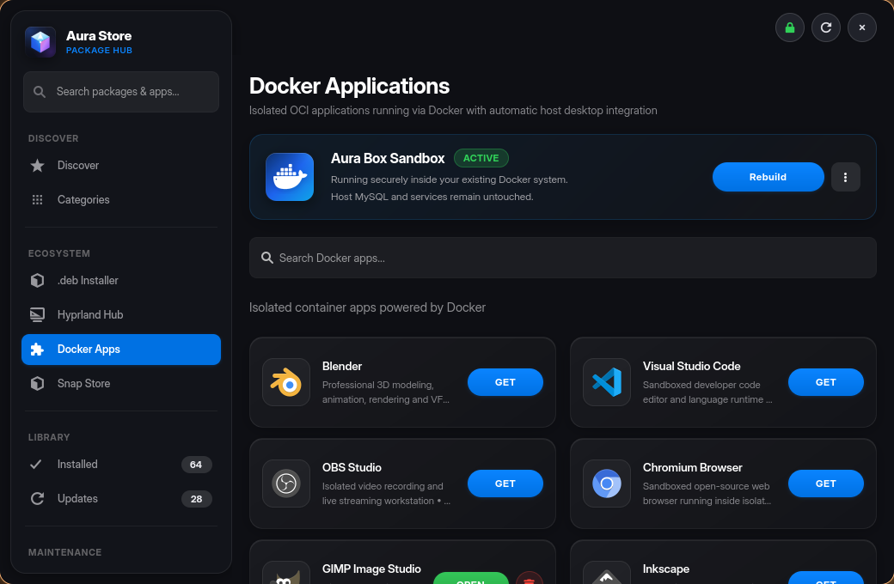

---

### 🔍 Full Package Inspector
Detailed software specifications, build dependencies, download sizes, licenses, upstream websites, and one-click actions.

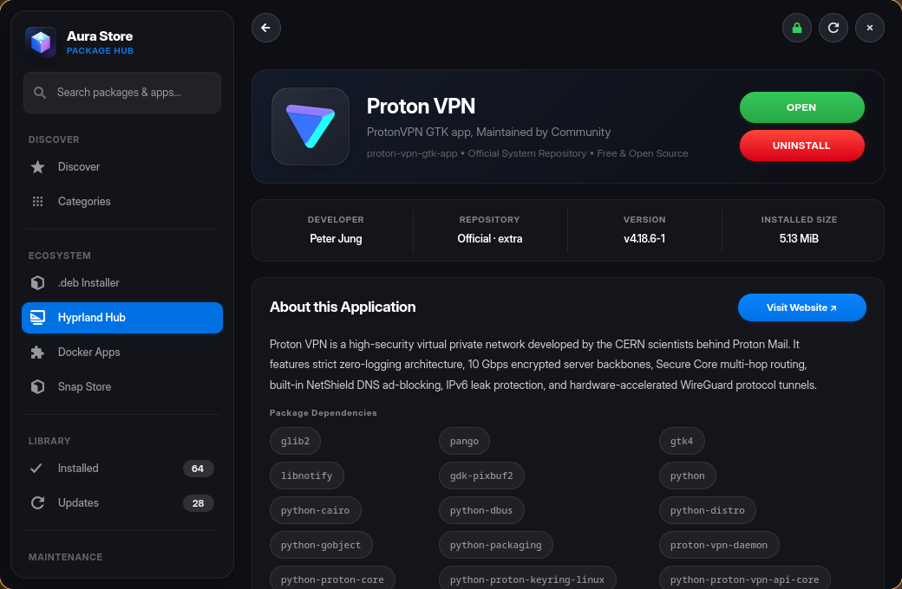

---

### 🩺 System Health, Pacman Doctor & Storage Cleaner
Recover stale `db.lck` locks, clean orphaned packages, repair Arch GPG keyrings, and prune caches with single-click actions.

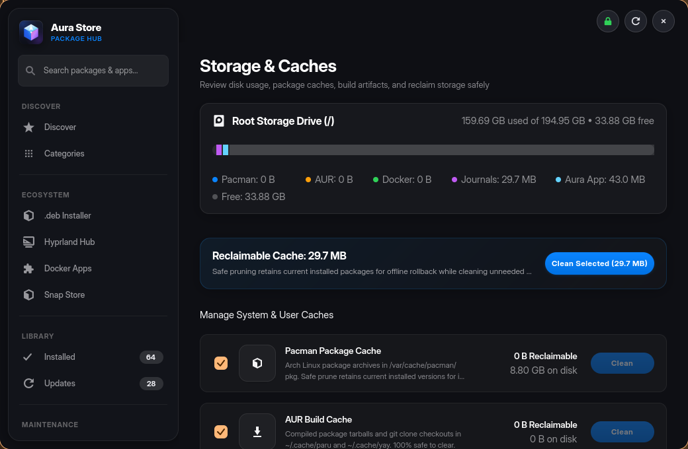

---

### ⚡ Batch Updates Manager & Installed Library
Instant status of all pending system upgrades with single-click batch updates and local desktop application management.

| Updates Page | Installed Applications |
| :---: | :---: |
| 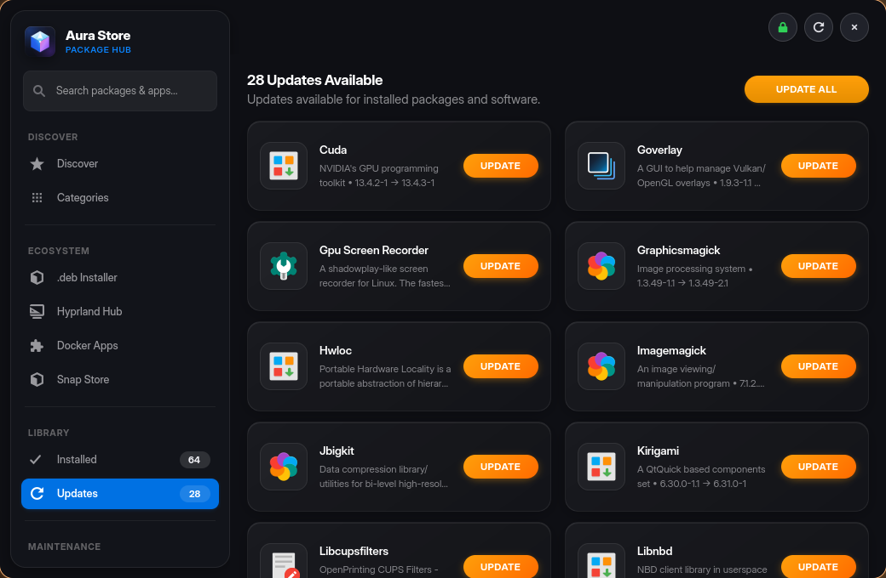 | 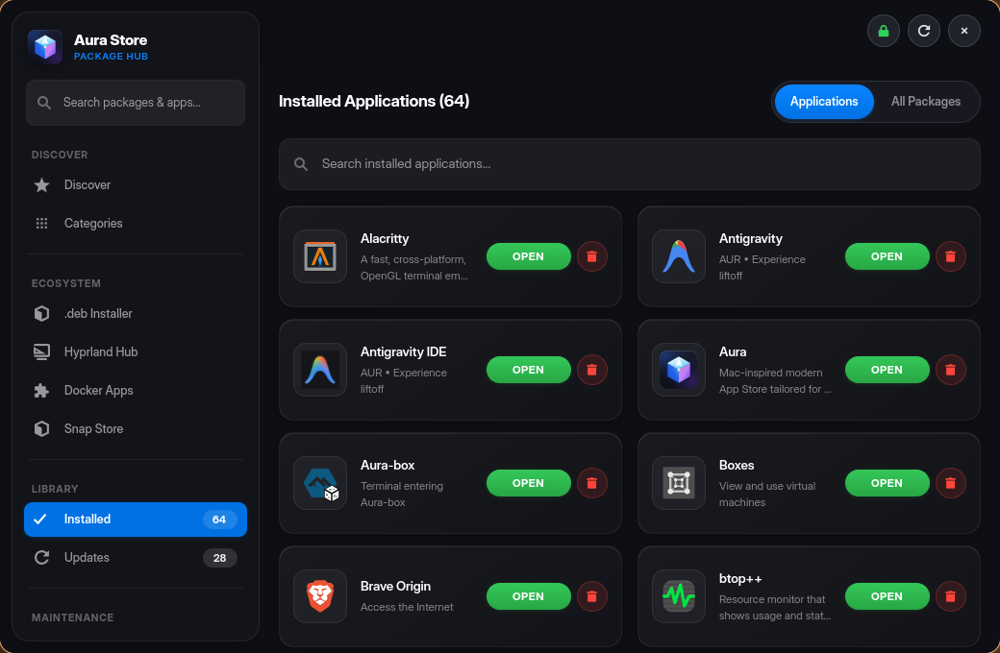 |

---

### 🛍️ Snap Store Integration
Access thousands of canonical and community Snaps alongside native Pacman and AUR repositories.

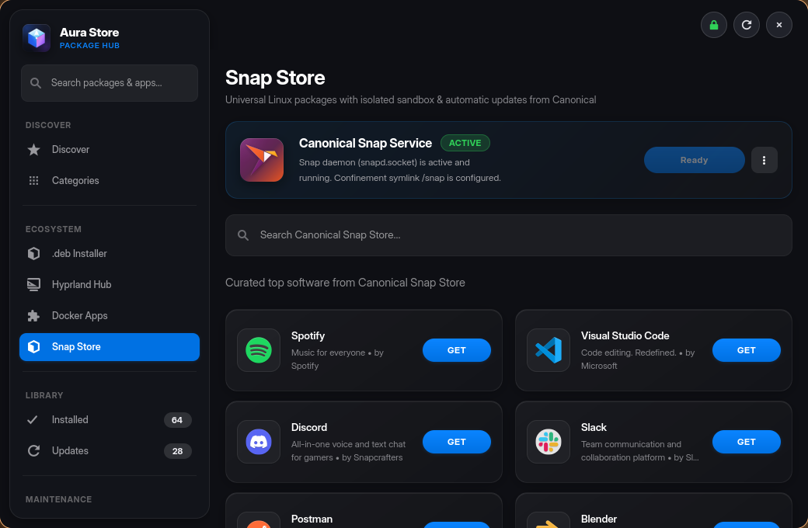

---

### 🛡️ Smart Confirmation Sheets & GTK4 Authentication
In-window modal sheets with clear explanations, protecting your system before any container installation, package removal, or privilege elevation.

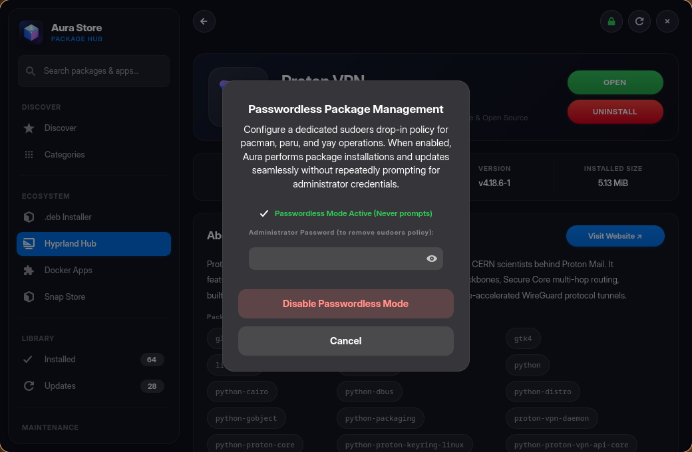

---

### 🎮 Curated Application Categories
Browse by Development, Gaming, Audio & Video, Internet, Utilities, and System tools.

| Development Suite | Gaming Hub |
| :---: | :---: |
| 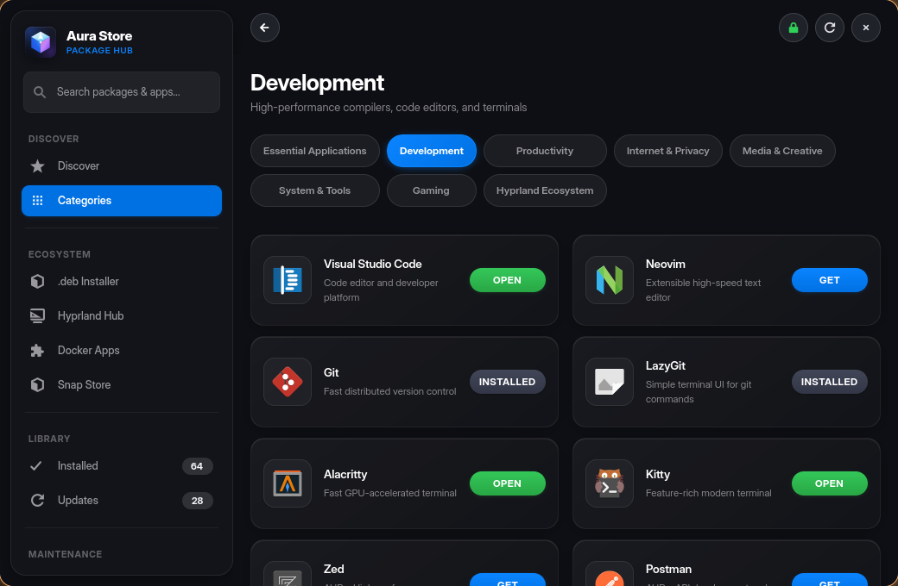 |  |

---

### 🔎 Instant Search & Fuzzy Filter
Sub-millisecond fuzzy search with live debouncing, category tags, and repository source badges.

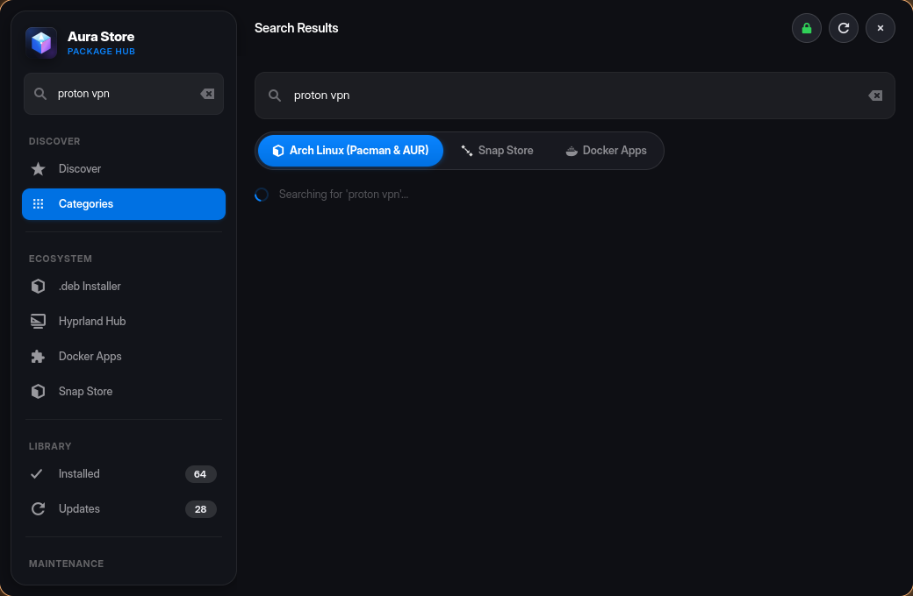

---

### 🖥️ Fullscreen 3-Column Experience
Seamlessly adapts from narrow half-screen tiling layouts to wide 1080p/4K triple-column layouts via dynamic Libadwaita breakpoints.

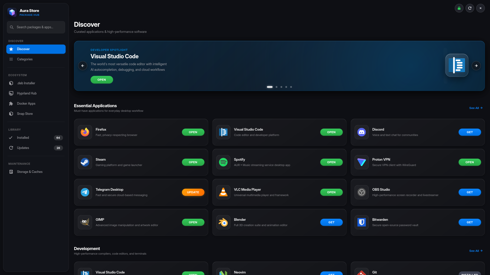

</div>

---

## 🪟 Purpose-Built for Hyprland

Aura is currently designed and tuned specifically for the **Hyprland Wayland compositor**:

- **Floating Centered Canvas**: Configured to launch as a smooth centered floating window (`1040x680`) with native Wayland decorations.
- **No Decoration Clutter**: Redundant titlebars and maximize/minimize buttons are stripped in favor of a sleek, minimal macOS-inspired header.
- **Glassmorphism & Opaque Rendering**: Built-in glass CSS styling with Hyprland `opaque` rule prevents blurry background conflicts.
- **Quick Shortcut Toggle**: Bind to `SUPER + A` to toggle your software library instantaneously.

### Hyprland Configuration

Add this line to your `~/.config/hypr/hyprland.conf`:

```ini
# Include Aura window rules
source = ~/.local/share/aura/data/hyprland-aura.conf
```

Or add the window rules and shortcut directly:

```ini
# Aura App Store - Window Rules & Shortcut
windowrulev2 = float, class:^(io.github.aura)$
windowrulev2 = center, class:^(io.github.aura)$
windowrulev2 = size 1040 680, class:^(io.github.aura)$
windowrulev2 = opaque, class:^(io.github.aura)$

# Instant Launcher Shortcut (Super + A)
bind = $mainMod, A, exec, aura
```

---

## 🚀 Quick Start

### One-Command Instant Installation

Run this single command in your terminal to automatically download, configure dependencies, and install Aura:

```bash
curl -fsSL https://raw.githubusercontent.com/Desplicableme/aura-store/main/install.sh | bash
```

Or clone manually:

```bash
git clone https://github.com/Desplicableme/aura-store.git
cd aura-store
./install.sh
```

---

### Arch User Repository (AUR)

If you are using an AUR helper such as `paru` or `yay`:

```bash
paru -S aura-appstore-git
# or
yay -S aura-appstore-git
```

Or build manually via `makepkg`:

```bash
git clone https://github.com/Desplicableme/aura-store.git
cd aura-store
makepkg -si
```

---

## 🛠️ System Requirements

| Component | Required Package | Notes |
| :--- | :--- | :--- |
| **Compositor** | Hyprland (Wayland) | Tailored specifically for Hyprland |
| **Operating System** | Arch Linux / CachyOS / EndeavourOS | Any `pacman`-based Linux distribution |
| **Python** | `python >= 3.10` | Core programming language |
| **GTK & Libadwaita** | `gtk4`, `libadwaita`, `python-gobject` | Modern graphical toolkit & design patterns |
| **Package Utilities** | `pacman-contrib`, `libarchive`, `zstd` | Required for update checks and `.deb` package bridge |
| **AUR Helper** | `paru` (preferred) or `yay` | Required for AUR search and builds |
| **Container Engine** | `docker` *(optional)* | Required only for the Docker Applications sandbox |
| **Debian Bridge** | `debtap` *(optional)* | Secondary fallback backend for complex `.deb` files |

---

## ⌨️ Command Line Usage

Aura supports deep command-line routing:

```bash
# Launch default Discover view
aura
aura --discover

# Open a .deb file directly in the .deb Package Bridge
aura ~/Downloads/package.deb
aura --deb ~/Downloads/package.deb

# Open the Hyprland Hub & Wayland Optimizer
aura --hyprland
aura -H

# Launch directly with a search query
aura "visual studio code"

# Open directly to Updates, Installed, Docker, Snap, or Storage & System Doctor
aura --updates
aura -u
aura --installed
aura --docker
aura -D
aura --snap
aura -S
aura --storage

# View details or install a package directly from CLI
aura --detail neovim
aura -d blender
aura --install waybar

# Explore a specific category (e.g. dev, games, productivity, media, security)
aura --category dev

# Open in fullscreen mode
aura --fullscreen
aura -f
```

---

## 📂 Project Structure

```
aura-store/
├── aura.py                     # Main application entry point & CLI parser
├── aura_backend.py             # Pacman, Paru, .deb Bridge, Hyprland & Container managers
├── aura_ui.py                  # GTK4/Libadwaita interface & macOS CSS system
├── aura-askpass                # Hardened GTK4/Wayland sudo askpass prompter
├── install.sh                  # Interactive system installer
├── uninstall.sh                # Clean uninstaller script
├── PKGBUILD                    # Arch Linux package specification
├── LICENSE                     # GNU General Public License v3
├── README.md                   # Project documentation
├── data/
│   ├── io.github.aura.desktop  # Desktop launcher entry
│   ├── io.github.aura.metainfo.xml # AppStream metadata
│   ├── hyprland-aura.conf      # Hyprland window rules config
│   └── icons/
│       ├── io.github.aura.svg  # Application icon
│       └── docker-symbolic.svg # Custom Docker symbolic icon
└── screenshots/                # Visual documentation assets
```

---

## 🤝 Contributing

Contributions are welcome! Whether it's adding new curated application categories, expanding Debian package translation mappings, improving translations, or enhancing UI animations:

1. Fork the Project
2. Create your Feature Branch (`git checkout -b feature/AmazingFeature`)
3. Commit your Changes (`git commit -m 'Add some AmazingFeature'`)
4. Push to the Branch (`git push origin feature/AmazingFeature`)
5. Open a Pull Request

---

## 📄 License

Distributed under the **GNU General Public License v3 (GPL-3.0-or-later)**. See [`LICENSE`](LICENSE) for more details.
