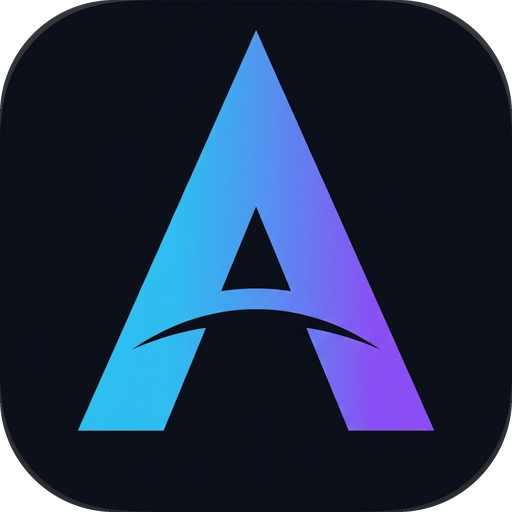
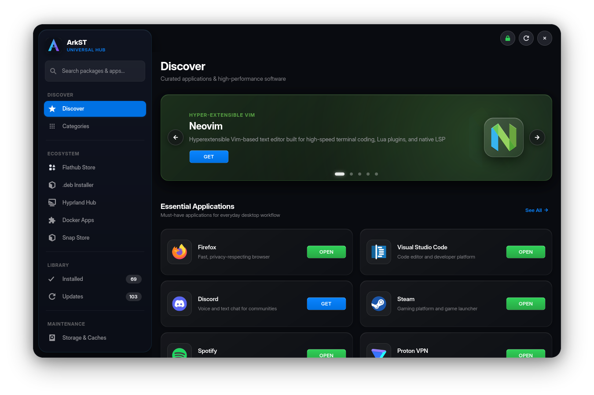
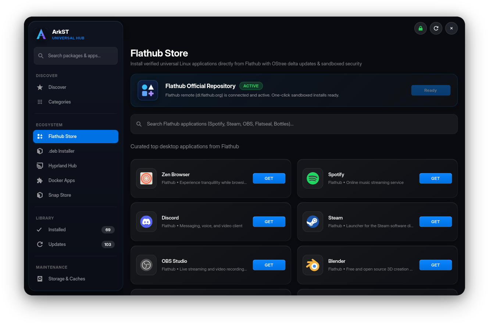
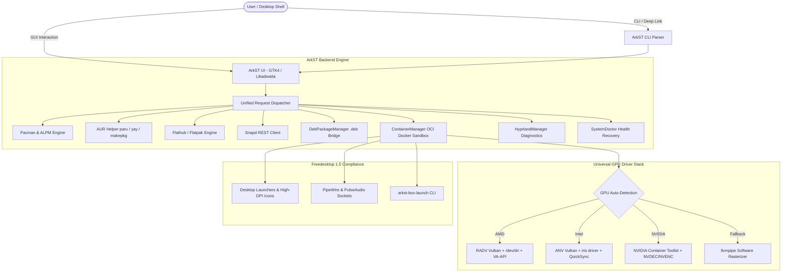

<div align="center">



# ▲ ArkST
### Universal Graphical Package Manager & Multi-GPU Container Sandbox
**Engineered natively for Arch Linux, Hyprland & Modern Wayland Desktops**

[](https://archlinux.org)
[](https://hyprland.org)
[](https://gnome.pages.gitlab.gnome.org/libadwaita/)
[](https://www.python.org/)
[](#-2-universal-multi-gpu-hardware-acceleration)
[](https://www.docker.com/)
[-brightgreen?style=for-the-badge&logo=pytest&logoColor=white)](#-automated-testing)
[](LICENSE)

<br/>

*ArkST is an ultra-fast, visually refined Linux software center unifying official Pacman repositories, the Arch User Repository (AUR), Flathub, Snap Store, isolated OCI Docker container sandboxes, and a seamless native `.deb` package bridge into a single, cohesive glassmorphic experience.*

<br/>



</div>

---

## 🌟 Core Pillars & Capabilities

### 📦 1. Universal Multi-Backend Package Engine
Orchestrate all your software sources from a single, unified interface:
- **Official Repositories**: Parallel query, inspect, and install from `core`, `extra`, `multilib`, `cachyos`, `chaotic-aur`, and custom mirrors.
- **Arch User Repository (AUR)**: Built-in native support for `paru` and `yay`, with automated fallback to `git clone` + `makepkg -si`.
- **Flathub Integration**: Discover, browse, install, and update Flatpaks with isolated sandbox permissions.
- **Snap Store**: Browse and install canonical Snap packages on Arch Linux with automatic `snapd.socket` detection.
- **Native `.deb` Package Bridge (`DebPackageManager`)**:
  - Install any Debian/Ubuntu `.deb` archive directly on Arch Linux via Drag-and-Drop, file dialog, HTTP/HTTPS URL, or CLI.
  - **175+ Ubuntu-to-Arch Dependency Mapping**: Translates Debian library conventions (including modern Ubuntu `t64` packages) into native Arch packages.
  - **FHS Normalization & `pacman -U` Tracking**: Re-packages binaries into compliant `.pkg.tar.zst` format so every file is tracked by Pacman for clean 1-click uninstalls.
  - **Ozone Auto-Injector**: Automatically detects Electron/Chromium `.deb` applications and injects Wayland Ozone platform hints to eliminate XWayland scaling blur.

---

### 🎮 2. Universal Multi-GPU Hardware Acceleration
ArkST features an intelligent hardware detection engine that configures rendering acceleration according to your active hardware:
- **AMD Radeon**: Automatically utilizes `/dev/dri`, RADV Mesa Vulkan, and VA-API hardware video acceleration (`mesa-va-drivers`).
- **Intel Iris / Xe / Arc**: Enables ANV Vulkan driver, Intel media driver, and QuickSync VA-API video decoding.
- **NVIDIA GeForce / RTX**: Automatically passes through `/dev/nvidia*`, NVIDIA Container Toolkit (`--gpus all` / `--runtime=nvidia`), NVDEC/NVENC, and falls back gracefully to software rasterization (`llvmpipe`) if proprietary drivers are absent.

---

### 🐳 3. Isolated OCI Docker Desktop Sandbox
Run complex, proprietary, or untrusted desktop applications (Chromium, Firefox, LibreOffice, GIMP, VLC, OBS Studio, etc.) in an isolated container without bloating your base Arch filesystem:
- **Universal XDG Desktop Shortcuts**: Automatically creates standard Freedesktop `.desktop` files in `~/.local/share/applications/` and high-DPI icons in `~/.local/share/icons/hicolor/`.
- **Universal Box Launcher (`arkst-box-launch`)**: Seamlessly launches any containerized app from system application menus (`rofi`, `wofi`, `walker`, `fuzzel`, GNOME App Grid, KDE Kickoff).
- **Audio & Display Pass-Through**: Automatic forwarding of Wayland sockets, X11 display sockets, PipeWire sockets, and PulseAudio native sockets (`/run/user/$UID/pulse/native`).
- **Clean Execution**: Chromium and Electron containers run cleanly without spurious sandbox banners using tested runtime flags.

---

### 🎨 4. Liquid Glassmorphic UI & Zero-Vibration Layout
- **Proportional Button Sizing**: Refined, modern rounded rectangle controls (`68x28`, `72x28`, `96x30`) with anti-aliased squircle borders and smooth hover feedback.
- **Zero-Vibration Layout Engine**: Eliminates GTK4 `GtkLabel` height oscillation and CSS hover-transform layout shifting across all views.
- **Instantaneous Search Cancellation**: Immediate request-ID cancellation on rapid typing and backspacing ensures zero stuck loading spinners and stale search results.
- **Dark Mode Native**: Tailored specifically for modern Wayland aesthetics with custom CSS glassmorphism, accent glows, and backdrop blurs.

---

### 🪟 5. Hyprland Hub & Wayland Diagnostics
- **Live Compositor Diagnostics**: Monitors `hyprctl version`, active displays (resolution, refresh rate, scaling factor), `xdg-desktop-portal-hyprland`, Polkit agents, status bars (`waybar`), wallpapers (`hyprpaper`, `swww`), and notification daemons (`swaync`, `dunst`).
- **1-Click Window Rules & Keybindings**: Injects ArkST floating window rules and `SUPER + A` shortcut into `~/.config/hypr/hyprland.conf` with instant live reload (`hyprctl reload`).
- **Wayland Ozone Optimizer**: One-click configuration of `electron-flags.conf`, `code-flags.conf`, `spotify-flags.conf`, `chromium-flags.conf`, and `brave-flags.conf` for razor-sharp HiDPI rendering.

---

### 🩺 6. System Health, Pacman Doctor & Storage Caches
- **Database Lock Recovery**: Detects and clears stale `/var/lib/pacman/db.lck` locks when no active package manager process is running.
- **Orphaned Package Cleanup**: Scans unneeded dependencies (`pacman -Qdt`) and purges them with one click.
- **Arch GPG Keyring Repair**: Re-initializes and refreshes `archlinux-keyring` and `pacman-key` to resolve signature verification failures.
- **Storage & Cache Pruning**: Inspects and prunes Pacman package caches (`/var/cache/pacman/pkg`), Flatpak runtimes, Snap revisions, and Docker images.

---

## 📸 Showcase Gallery

<div align="center">

### 🌟 Discover Hub
*Curated essential software, development suites, privacy tools, and media applications arranged in dynamic multi-column responsive grids.*


---

### 🐳 Docker Applications Sandbox
*Run desktop applications in isolated OCI containers with automatic desktop menu shortcuts, audio forwarding, and hardware acceleration.*


---

### 🛍️ Flathub Store Integration
*Browse, search, install, launch, and manage Flathub packages alongside native Arch packages.*



---

### 📦 Seamless Native `.deb` Package Bridge
*Inspect Debian/Ubuntu packages, resolve dependencies to Arch equivalents, normalize FHS paths, and track via Pacman.*


---

### 🪟 Hyprland Hub & Wayland Diagnostics
*Live compositor diagnostics, 1-click floating window rules injection, Wayland Ozone optimizer, and curated Hyprland utilities.*


---

### ⚡ Batch Updates Manager & Installed Library
*Monitor pending upgrades and manage installed system software with single-click batch operations.*

| Batch Updates | Installed Applications |
| :---: | :---: |
|  |  |

---

### 🩺 System Health & Storage Caches
*Resolve stale locks, clean orphaned packages, repair Arch GPG keyrings, and prune caches safely.*


---

### 🔍 Deep Package Inspector
*Inspect complete dependencies, maintainers, package licenses, sizes, and installation targets.*


---

### 📦 Snap Store Integration
*Browse and install canonical Snap packages on Arch Linux with automatic socket verification.*


</div>

---

## 🚀 Installation

### Option 1: Automated 1-Click Installer (Recommended)
ArkST includes an automated installer that checks dependencies, configures icons and desktop entries, and sets up Wayland rules:

```bash
git clone https://github.com/Desplicableme/arkst.git
cd arkst
chmod +x install.sh
./install.sh
```

### Option 2: Arch Linux PKGBUILD (`makepkg`)
ArkST provides a fully compliant Arch Linux `PKGBUILD`:

```bash
cd arkst
makepkg -si
```

### Option 3: Run Directly From Source
ArkST can be executed portably without system installation:

```bash
python3 arkst.py
```

---

## 💻 Command Line Interface & Deep Linking

ArkST supports rich command-line parameters and custom URL protocols (`arkst://`, `appstream://`):

```bash
# Launch default Discover view
arkst

# Launch directly into Docker Applications sandbox
arkst --docker            # or arkst -D

# Launch directly into Flathub Store
arkst --flathub           # or arkst -F

# Launch directly into Installed Applications
arkst --installed

# Launch directly into System Updates
arkst --updates           # or arkst -u

# Launch directly into Hyprland Hub
arkst --hyprland          # or arkst -H

# Launch directly into Storage & Pacman Doctor
arkst --storage

# Search for any package across all repositories
arkst --search "vlc"

# Install or inspect a Debian .deb file
arkst my-app.deb
arkst --deb my-app.deb

# Launch an installed containerized app directly
arkst-box-launch vlc
arkst-box-launch chromium
```

---

## 🏗️ Architecture & Component Flow



---

## 🧪 Automated Testing

ArkST maintains an exhaustive automated test suite covering all package backends, container lifecycles, and UI state synchronization:

```bash
python3 -m unittest discover tests
```

```text
Ran 114 tests in 31.851s
OK
```

All 114 unit tests verify:
- AUR and Pacman search & detail caching
- Docker container creation, socket mounting, and lifecycle management
- Flathub integration and async update card synchronization
- `.deb` dependency resolution and Arch packaging normalization
- Hyprland window rules injection and monitor querying
- Storage cache calculations and GPG keyring recovery

---

## 📄 License

ArkST is free, open-source software distributed under the terms of the **GNU General Public License v3.0 or later** ([GPL-3.0-or-later](LICENSE)).
